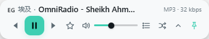

# radiobar

一条常驻桌面的电台播放条。340×64 的无边框小窗，不占地方，点开就能听；需要找台时展开面板搜索、筛选、收藏。

## 下载与运行

从 [Releases](https://github.com/injoyai/radiobar/releases) 下载 `radiobar.exe`，或自行[构建](docs/DEVELOPMENT.md)。

radiobar 只有一个文件，绿色便携，双击即用，无需安装。

建议放到一个固定目录再运行（例如 `D:\Apps\radiobar`），以后每次双击同一个 exe 即可，收藏、音量、位置都会保留。

- 系统要求：Windows 10 / 11（x64）
- 需要 WebView2 运行时：Win11 自带；Win10 通常随 Edge 一起装好了
- 数据写在 `%APPDATA%\com.local.radiobar\`，与 exe 放在哪里无关，换目录不丢配置

## 使用

### 折叠条

从左到右：

| 按钮 | 作用 |
|------|------|
| ◀ / ▶ | 上一台 / 下一台 |
| ⏵ / ⏸ | 播放 / 暂停 |
| ☆ | 收藏当前电台（再点取消） |
| 🔊 + 滑块 | 静音开关；拖动调音量，滚轮在滑块上每格 ±2 |
| 范围图标 | 切换播放范围：收藏 → 列表 → 全部 |
| 模式图标 | 切换播放模式：顺序 → 循环 → 随机 |
| ⌄ | 展开 / 收起面板 |
| 📌 | 置顶（窗口始终在最前） |

- 拖动条的上半部分（台名那一行）可移动窗口，松手后自动贴边（离屏幕边缘 20 px 内即吸附），位置会记住。
- 双击同一行 = 展开 / 收起面板。
- 「列表」范围指面板里当前搜索 + 国家筛选的结果，「全部」指整个本地库。

### 面板

- **搜索**：按台名、国家名或标签搜，边打边筛。
- **国家筛选**：下拉选国家，括号里是该国的台数。
- **只看收藏**：列表只留收藏过的台，同时把播放范围切到「收藏」；再点一次恢复。
- **点击任意一台**立即播放；播放失败时按设置决定是否自动切下一台。
- **翻页**：每页 50 台，底部显示「共 N 台 · 上次同步时间」。
- **更新**：从 radio-browser 增量同步电台库（每个国家取最热的 50 台），已有电台按最新数据刷新，新电台追加，不动收藏。

### 设置（面板底部右侧的齿轮）

- **启动时自动播放**：程序启动时直接续播上次的电台（上次退出时正在播放也会续播）。
- **播放失败自动切台**：当前电台连不上时自动跳到下一台（默认开启）。
- **快捷键**：点击键位即可改绑，见下节。

### 托盘与退出

- 左键托盘图标：显示 / 隐藏窗口。
- 右键托盘图标：显示窗口、播放/暂停、上一台、下一台、置顶、更新电台库、退出。
- 窗口无标题栏，没有关闭按钮；按 `Alt + F4` 关闭 = 收进托盘，播放继续。要真正结束进程，用托盘菜单里的「退出」。

## 全局快捷键

播放器不在前台、甚至收进托盘时也能控制：

| 动作 | 默认键位 |
|------|----------|
| 上一台 | `Ctrl + ←` |
| 下一台 | `Ctrl + →` |
| 音量 + | `Ctrl + ↑` |
| 音量 − | `Ctrl + ↓` |
| 播放 / 暂停 | `Ctrl + P` |

面板 → 设置 → 快捷键里点任意键位即可录制新组合：按下想用的组合键生效，`Esc` 取消。

- 组合键必须带修饰键（`Ctrl` / `Alt` / `Shift` / `Win` 至少一个）。
- 与已有键位重复会被拒绝，并提示占用了哪个动作。
- 改绑立即生效并写入 `state.json`，重启后保持。

## 电台数据

电台来自开源项目 [radio-browser](https://github.com/radio-browser/radio-browser)（数据 CC0）。

随包内置一份快照（每国 top50 + 全球 top500 去重，共 5,941 台），所以第一次启动就有台可听，不用先同步。之后可在面板里点「更新」增量同步到本地库：已有电台按最新数据刷新，新电台追加，收藏不会丢。

电台本身已下线时，列表里会标注「暂不可用」，自动切台和播放队列会跳过它们。

## 数据与配置

`%APPDATA%\com.local.radiobar\`

- `state.json` — 音量、模式、范围、置顶、窗口位置、收藏、快捷键、上次同步时间等
- `stations.local.json` — 本地电台库，第一次点「更新」后生成，之后只增量合并

删掉整个目录即恢复出厂状态。

## 常见问题

**启动后没窗口 / 双击没反应？**
可能已经在运行（radiobar 只允许一个实例）。看托盘区，左键点一下图标即可唤回窗口。

**窗口不见了？**
它可能被收进托盘了，或贴在屏幕某条边上。托盘右键 →「显示窗口」。

**某个台点了没声音？**
该台可能已下线或暂时不可用，换一台即可；也可以在设置里开启「播放失败自动切台」。

**换电脑怎么带走收藏？**
复制整个 `%APPDATA%\com.local.radiobar\` 目录过去即可。

## 开发

源码构建、测试、目录结构与已知限制见 [docs/DEVELOPMENT.md](docs/DEVELOPMENT.md)。
